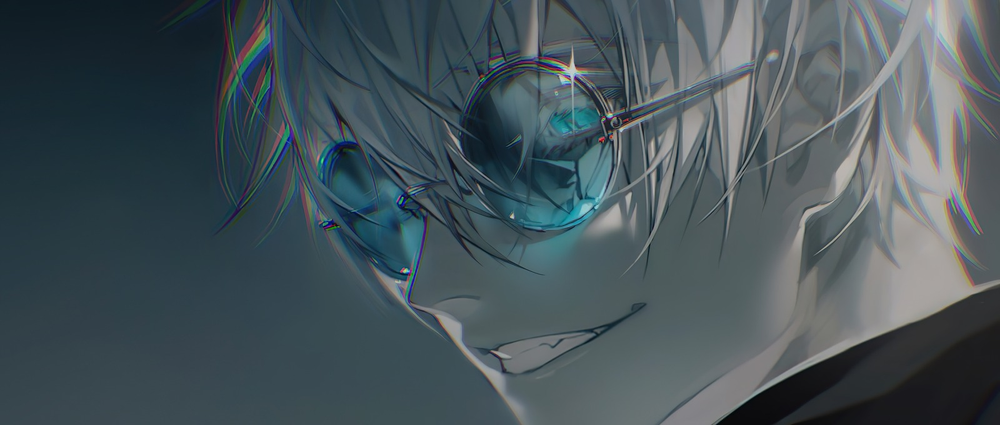
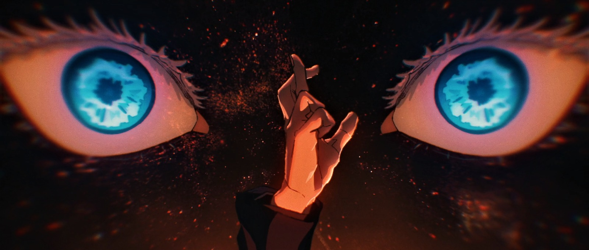

  
    
  
<b>dejavu</b> &nbsp;·&nbsp; <i>"Peace is all I seek."</i>

 

### Projects

- **[Lordspey](https://github.com/Dathevinci/Lordspey)** — Minimal Obsidian-inspired workspace for drafts, lore, worldbuilding, and interactive cartography · [live](https://dathevinci.github.io/Lordspey/)
- **[Deja](https://github.com/Dathevinci/Deja)** — Desktop YouTube Music client with Apple Music design language and BitChord native audio
- **[RCD](https://github.com/Dathevinci/RCD)** — Consent-first WebRTC P2P remote desktop and live support with a lightweight native helper
- **[Blog](https://github.com/Dathevinci/Blog)** — Full-stack anime and manga streaming platform with custom HLS proxy and AniList sync

 

### Stack

`JavaScript` · `TypeScript` · `React` · `Next.js` · `Node.js` · `C#` · `PostgreSQL` · `WebRTC` · `Tailwind CSS`

 

<table width="100%">
  <tr>
    <td width="50%" align="center">
      
    </td>
    <td width="50%" align="center">
      
    </td>
  </tr>
</table>

  
    
  <i>天上天下唯我独尊</i>

