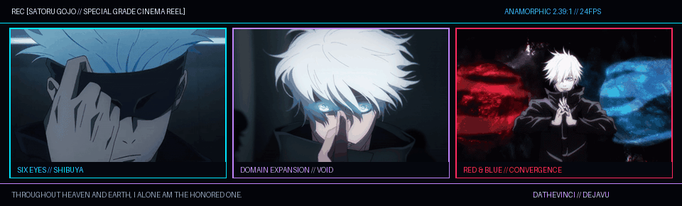
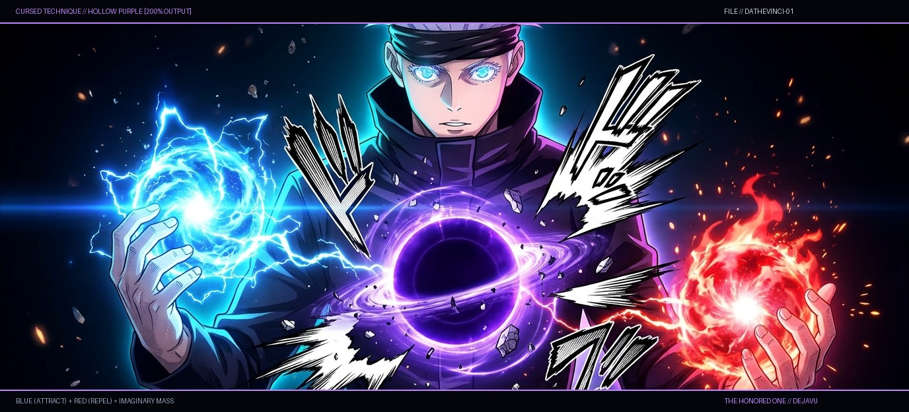
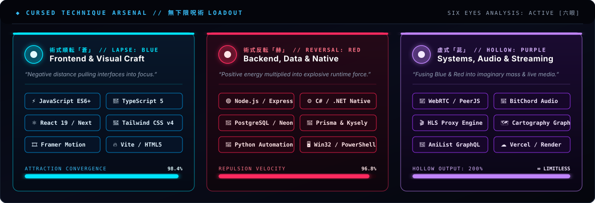
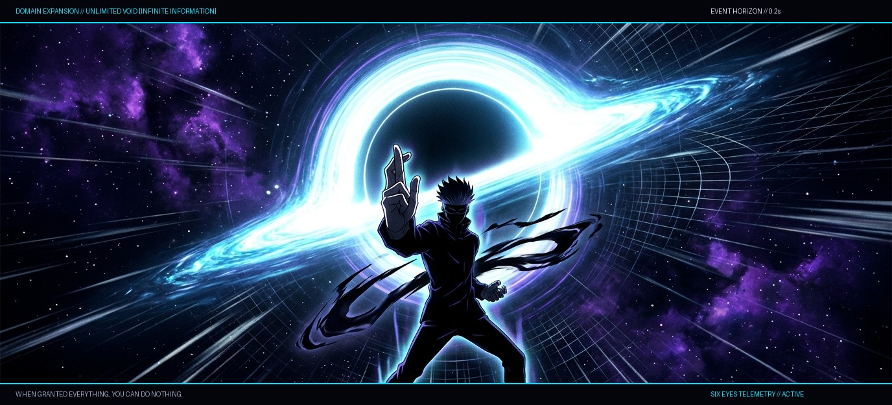
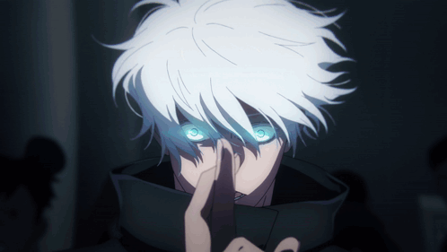
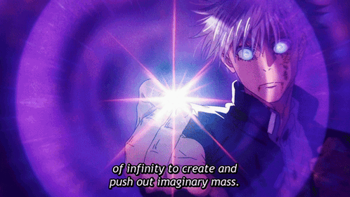
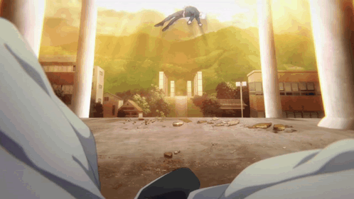
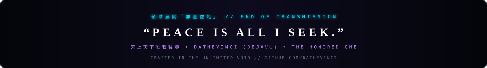

<!-- ==================== ACT I: OPENING CINEMA TITLE CARD ==================== -->

 

<!-- QUICK HUD STATUS PILLS -->

  
  
  
  

<!-- ==================== ACT II: WIDESCREEN ANIME CINEMA REEL ==================== -->

<b>▲ SCENE 01 // THE HONORED ONE:</b> <i>Six Eyes Awakening (六眼)  •  Domain Expansion: Unlimited Void (無量空処)  •  Cursed Technique Convergence (蒼 & 赫)</i>

  

 

<!-- ==================== ACT III: SORCERER DOSSIER // SIX EYES TELEMETRY ==================== -->
<table>
  <tr>
    <td width="44%" valign="middle" align="center">
      
       
      <code>[ 六眼 // SIX EYES PERCEPTION: ACTIVE ]</code>
    </td>
    <td width="56%" valign="middle">
      <h3><code>⚡ // SORCERER DOSSIER : DATHEVINCI</code></h3>
      <blockquote>
        <i>“Throughout Heaven and Earth, I alone am the Honored One.”</i> 
        <b>— Satoru Gojo (五条 悟)</b> &nbsp;|&nbsp; <code>"Peace is all I seek."</code>
      </blockquote>
      <pre lang="yaml">
OPERATOR    :: Dathevinci (dejavu)
CLASS       :: Special Grade Full-Stack & Systems Engineer
INNATE TECH :: Limitless Architecture (無下限呪術)
PERCEPTION  :: Six Eyes UI/UX & Zero-Latency Telemetry (六眼)
DOMAINS     ::
  ✦ Lordspey  -> Obsidian-inspired Lore, Drafts & Cartography
  ✦ Deja      -> Apple Music-styled Desktop Client + BitChord DSP
  ✦ Prashnaa  -> Consent-First WebRTC P2P Remote Desktop + C#
  ✦ Lucid     -> Full-Stack Anime & Manga HLS Streaming Suite
PHILOSOPHY  :: Building high-craft, zero-friction software where
               complex infrastructure vanishes behind effortless UI.</pre>
    </td>
  </tr>
</table>

 

<!-- ==================== ACT IV: HOLLOW PURPLE & CURSED TECHNIQUE ARSENAL ==================== -->
<h3><code>虚式「茈」 // HOLLOW TECHNIQUE: PURPLE — FULL-STACK CONVERGENCE</code></h3>

<i>When the attraction of <b>Lapse: Blue (Frontend Craft)</b> collides with the repulsion of <b>Reversal: Red (Systems & Native Power)</b>, an imaginary mass is born.</i>

  

  

<!-- TECH STACK SHIELDS -->

  
  
  
  
  
  
  
  
  

 

<!-- ==================== ACT V: DOMAIN EXPANSION // ACTIVE REPOSITORIES ==================== -->
<h3><code>領域展開「無量空処」 // DOMAIN EXPANSION: FEATURED ARCHIVES</code></h3>

<i>Select any domain card below to inspect the source repository or launch the live deployment.</i>

  

<table>
  <tr>
    <td width="50%" align="center">
      
    </td>
    <td width="50%" align="center">
      
    </td>
  </tr>
  <tr>
    <td width="50%" align="center">
      
    </td>
    <td width="50%" align="center">
      
    </td>
  </tr>
</table>

 

 

<!-- ==================== ACT VI: CINEMATIC CUTS // ARCHIVE GALLERY ==================== -->
<h3><code>🎬 // JUJUTSU TECH VISUAL ARCHIVE — CINEMATIC CUTS</code></h3>

<table>
  <tr>
    <td width="33%" align="center">
      
       
      <b>領域展開「無量空処」</b> <i>0.2s Domain Expansion</i>
    </td>
    <td width="33%" align="center">
      
       
      <b>虚式「茈」</b> <i>200% Hollow Technique: Purple</i>
    </td>
    <td width="33%" align="center">
      
       
      <b>天上天下唯我独尊</b> <i>The Honored One Awakening</i>
    </td>
  </tr>
</table>

 

<!-- ==================== ACT VII: CLOSING CREDITS ==================== -->

